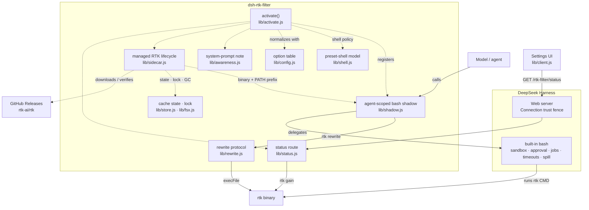

# RTK for DeepSeek Harness

English | [中文](README_zh.md)

Transparently runs the DeepSeek Harness `bash` tool through [RTK](https://github.com/rtk-ai/rtk)
so condensed command output reaches the model. The plugin adds **no tool** and
changes no tool schema: it registers an agent-scoped `bash` tool that shadows
the built-in one, rewrites each supported command to its `rtk` equivalent, and
then delegates to the original bash implementation.

The plugin also installs and updates its own RTK binary under
`$DSH_HOME/cache/rtk-filter`. You do not need to install RTK globally, and a
bundled or linked checkout never writes into a user `PATH` directory.

Because execution delegates back to the built-in tool, sandboxing, approval,
background jobs, timeouts, output rendering, spill files, and `[exit code: N]`
markers behave exactly as before. Only the command that runs, its `PATH`
overlay while a managed binary is active, and the output the model reads change.

The same plugin adds **Settings → RTK command filtering** to the Web GUI, with a
compact status dashboard and a placeholder for future options.

## How it works

```
model calls bash("git status")
  -> agent-scoped bash shadow
  -> rtk rewrite "git status"        (0/3 = rewrite, 1 = pass, 2 = deny)
  -> built-in bash runs "rtk git status", with the managed rtk on PATH
  -> RTK-filtered output returns through the normal bash result path
```

- The shadow's `description`, `parameters`, `output`, timeouts, and
  presentation callbacks are getters over the `bash` definition inherited by
  that agent, captured before the shadow is registered. In the Web surface the
  built-in tool is composed by the agent preset rather than the host global
  plane, so the plugin reads it through the agent's own tool view.
- A short system-prompt section explains that bash output may be condensed by
  RTK. Disable it with `awareness: false`; the tool set never changes.
- All rewrite logic lives in the `rtk` binary (`rtk rewrite`). When filters are
  added to RTK, this plugin picks them up with no change.

## Architecture

Solid arrows show component dependencies and invocation paths; dashed arrows
show activation, binary-management, and settings control relationships. The
command-level round trip is shown in [How it works](#how-it-works).



Shared helpers: `lib/proc.js` (child process, abort contract, error text) is
used by both the filter and the installer. The full module map, dependency
rules, and single-sources-of-truth are in
[ARCHITECTURE.md](docs/ARCHITECTURE.md).

## Requirements

- POSIX `bash` (the built-in `bash` tool). Windows `pwsh` is not covered.
- No system `rtk` is required. The plugin downloads and verifies its own copy
  (RTK >= 0.23.0, when `rtk rewrite` was introduced) on first use.
- Network access to `github.com` on first activation unless `binary` or
  `RTK_BIN` names an existing executable.
- An explicit `binary` must be an executable named `rtk` (or a bare `rtk`
  command resolved through `PATH`); rewritten commands invoke `rtk`.

If no binary can be obtained, the plugin logs a warning and stays inert: bash
and the prompt are unchanged.

## Install

Install this repository as a bundle with the DSH Plugin Manager — use the
`plugin_manager` tool with `action: install_bundle` and the absolute path to
this repository directory as `target`. The bundle patch inserts one row:

```yaml
- insert:
    - id: rtk-filter
      name: '@rtk-ai/dsh-rtk-filter'
```

Remove it with `plugin_manager` `action: remove_bundle`.

The first activation starts the RTK download in the background. Filtering
begins automatically when the binary is ready; no restart and no shell command
is needed.

## RTK binary lifecycle

### Where it lives

```
$DSH_HOME/cache/rtk-filter/                  # default ~/.dsh/cache/rtk-filter
  versions/<edition>/<target>/<version>/rtk  # executable, mode 0755
  state/<edition>__<target>.json             # installed version for this target
  latest.json                                # cached latest stable tag
  locks/                                     # cross-process install locks
  tmp/                                       # staging; stale entries are cleaned
```

`$DSH_HOME` is read from the live profile (`profileContext.home`), then
`$DSH_HOME`, then `~/.dsh`. The cache is user-owned and shared by DSH profiles;
it is not added to the operating system `PATH` or to any shell profile.

### Precedence

1. `RTK_BIN` in the Host environment, or a non-default `binary` config:
   use it as-is. No download and no update.
2. The plugin-managed copy, which the plugin keeps updated.
3. A system `rtk` on the Host `PATH`, used immediately as a temporary fallback
   while the managed copy is downloaded, or permanently if the download fails.
4. If nothing is available and `autoInstall` is enabled, download the latest
   stable release in the background and start filtering when it is ready.
5. Otherwise stay inert with a warning; bash and the prompt remain untouched.

A managed copy is preferred over `PATH` once it is ready, so `PATH`
installations are never modified and updates stay under plugin control.

### Install and update

- The latest stable tag is resolved from
  `https://github.com/rtk-ai/rtk/releases/latest`; the GitHub API is only a
  fallback.
- The matching `rtk-<target>.tar.gz` (or `rtk-oss-<target>.tar.gz`) is
  downloaded together with `checksums.txt`; the SHA-256 is verified before
  extraction.
- The archive is read with Node's `zlib` and a defensive tar parser: unsafe
  paths, links, duplicates, truncation, and oversized entries are rejected.
- The extracted `rtk` is run with `--version` (must match the requested tag and
  be >= 0.23.0) and with a rewrite smoke test (`rtk rewrite` on `git status` or
  `ls`; at least one must rewrite) before it is published.
- Publishing is an atomic rename into a versioned directory, followed by an
  atomic state write. An update never overwrites a running binary.
- `autoUpdate` checks once per `updateIntervalMs` (default 24 h) and upgrades
  the managed copy when the latest stable tag is newer. The previous version is
  retained; older versions are garbage-collected.
- `version` pins an exact tag (`1.2.0` or `v1.2.0`) and disables latest-version
  lookups. Downgrades happen only when pinned explicitly.
- `edition: rtk-oss` downloads the Apache-2.0-only build instead of the default
  `rtk` build (Apache-2.0 CLI plus the BUSL-1.1 engine). The plugin downloads
  the release from upstream; it does not redistribute it. The archive's
  `LICENSE` and `LICENSE-ENGINE` files are kept beside the binary.

The trust model is HTTPS plus upstream SHA-256 plus a local rewrite smoke
test; upstream does not publish signatures. Set `autoInstall: false` to opt out
of downloading.

### Running with a managed binary

The inherited bash tool resolves `rtk` from its own `PATH`, not from the
plugin's configured binary. While a managed (or explicit absolute) binary is
active, the shadow prepends its directory to `PATH` for every delegated
command:

```
export PATH='<version-dir>':"$PATH"; <command>
```

That makes `rtk`, `rtk bypass ...`, and `rtk` calls inside compound commands and
scripts work. The overlay is not applied when the chosen binary is the bare
`rtk` from `PATH`, while no binary is ready, for empty commands, or when
`RTK_DISABLED=1` is set.

## Configuration

Edit the inserted row in the profile's `cordis.patch.yml` (or the bundle row)
and set `config`:

```yaml
- id: rtk-filter
  name: '@rtk-ai/dsh-rtk-filter'
  config:
    autoInstall: true          # default: true
    autoUpdate: true           # default: true
    version: latest            # default: latest, or a tag such as v1.2.0
    edition: rtk               # default: rtk, or rtk-oss
    awareness: true            # default: true
    rewriteTimeoutMs: 2000     # default: 2000
    logRewrites: false         # default: false
```

| Field | Default | Meaning |
|---|---|---|
| `enabled` | `true` | Turn the plugin off without removing it. |
| `awareness` | `true` | Add the short system-prompt section about condensed output. |
| `binary` | `rtk` | Explicit rtk executable. Setting it (or `RTK_BIN`) disables managed install/update; use an absolute path or a bare `rtk`. |
| `autoInstall` | `true` | Download a plugin-owned binary when no managed copy exists. |
| `autoUpdate` | `true` | Check GitHub and upgrade a managed copy. `PATH` and explicit binaries are never updated. |
| `version` | `latest` | Pin an exact stable tag; disables latest-version lookups. |
| `edition` | `rtk` | `rtk` or the Apache-2.0-only `rtk-oss`. |
| `updateIntervalMs` | `86400000` | Minimum time between latest-tag checks. |
| `downloadTimeoutMs` | `120000` | Timeout for one checksums or archive request. |
| `rewriteTimeoutMs` | `2000` | Timeout for one `rtk rewrite` call; on timeout the original command runs. |
| `logRewrites` | `false` | Log `[rtk] <original> -> <rewritten>` to the Host log. |

A bundle linked from a checkout cannot resolve DSH's shipped Node packages, so
the generated Config schema is absent there (the row status is `absent` in the
Config inspector). The fields above still work: the row's raw `config` reaches
the plugin and the same defaults apply.

## Settings page

The Web GUI adds **Settings → RTK command filtering** with a compact top bar
for its two views:

- **Status** — runtime health and version, plus a compact dashboard for the
  selected window (last 7 or 30 days): RTK calls, tokens saved, savings rate,
  average saved per call, and a daily savings bar chart. The numbers are read
  from RTK's own local tracking database through `rtk gain --daily --format
  json`; they therefore summarize every command RTK recorded on this machine,
  not only the current browser session.
- **Settings** — a placeholder for future plugin options. Nothing needs tuning
  there today; configuration still lives in the profile row shown above.

The browser reads the aggregate payload from the same-origin
`GET /rtk-filter/status?days=7` resource. The Host route is fenced by the
Connection trust check when that service is composed and never returns command
text or binary paths. Turning the plugin off removes the route; the settings
section then shows its normal retry/error state.

## Behavior

`rtk rewrite` exits with a permission decision; the plugin interprets it the
same way the Pi/OMP and Hermes delegates do, without setting
`RTK_REWRITE_HOST`:

| Exit | Plugin action |
|---|---|
| `0` + stdout | Run the rewritten command. |
| `1` | Run the original command (no filter, or a construct RTK does not rewrite). |
| `2` | Do **not** run; the tool call fails with `rtk denied this command: <message>`. |
| `3` + stdout | Run the rewritten command. DSH owns approval for the bash call, so there is no second prompt. |
| timeout / spawn error / unknown | Fail open: run the original command. |

Additional rules:

- Commands that already start with `rtk` are not rewritten (no recursion); the
  `PATH` overlay still applies while a managed binary is active.
- `RTK_DISABLED=1` in the Host environment skips plugin activation entirely.
  A per-command `RTK_DISABLED=1 <cmd>` prefix is skipped by `rtk rewrite`
  itself and runs unchanged.
- `rtk rewrite` runs with the session's working directory, so project-local
  permission rules resolve the way they do for a normal command.

## What the agent sees

- The same one `bash` tool, with the same name, description, and parameters.
- RTK-filtered output for commands RTK supports; unchanged output otherwise.
- A short prompt note that bash output may be condensed and how to recover it
  (`rtk bypass <cmd>`), unless `awareness: false`.

## Limitations

- **Session log**: the durable `tool/call` records the command the model wrote,
  not the rewritten one or the `PATH` overlay. The rewrite is visible in the
  Host log only with `logRewrites: true`.
- **Approval**: DSH has no per-command prompt, so an `ask` rule in Claude Code
  settings (exit 3) does not prompt here; `deny` rules still block. The command
  runs under the approval the `bash` tool call already received.
- **Tool restrictions**: DSH lets scoped registrations remain visible under
  `tools.restrict`, so a preset that denies the global `bash` tool for an agent
  does not hide this shadow. The stock profile and plan mode do not deny
  `bash`.
- **Platform**: POSIX `bash` only; the Windows `pwsh` tool is not filtered.
  Managed downloads support Linux and macOS on x64 and arm64.
- **Inherited definition**: the plugin captures the agent's `bash` definition
  when it installs for that agent. Once the shadow owns the `bash` name the
  agent's own lookup returns the shadow, so a later replacement is not visible
  through `tools/change`; the mirror is re-captured when the agent's preset
  changes, and the shape guard then decides whether the new bash may be
  mirrored. The preset in force is read from the registry projection
  (`presetForSession`), not the creation header: the Web surface creates a
  session under the registry default and selects the user's preset afterwards,
  so a switched session's header records the preset it was born with.
- **Preset shape guard**: the `minimal` preset's bash accepts `command` only.
  When the captured `bash` declares other parameters (the standard
  `dsh-tool-bash` declares `description`/`workdir`, for example), the plugin
  treats that definition as belonging to another plane and installs nothing:
  it filters less rather than changing the tool's schema and execution
  semantics. Unlisted presets are unaffected.
- **Managed binary scope**: the plugin-owned RTK is on `PATH` only inside bash
  calls it delegates, not in the user's terminal or other DSH processes. A
  system `rtk` is not updated by the plugin; explicit `binary`/`RTK_BIN`
  binaries are never managed.
- **First activation**: with no usable binary and `autoInstall: true`, filtering
  is unavailable until the background download finishes. If the network is
  blocked, the plugin falls back to a system `rtk` or stays inert and logs a
  warning.
- **Trust**: downloads are verified against upstream SHA-256 checksums, not
  signatures. Use `autoInstall: false` and an explicit `binary` where
  third-party downloads are not allowed.
- **Cache maintenance**: deleting `$DSH_HOME/cache/rtk-filter` forces a clean
  reinstall on the next activation. The cache retains the current and one
  previous version per edition/target.

## Development

Unit tests use only Node built-ins and generated tar fixtures:

```bash
node --test test/*.test.mjs
```

The release pipeline can be exercised against upstream once with a temporary
home; no global installation is involved:

```bash
DSH_HOME=$(mktemp -d) node --input-type=module -e "
import { createRtkManager } from './lib/sidecar.js'
import { probeRtk, rewriteCommand } from './lib/rewrite.js'
const manager = await createRtkManager({
  ctx: { get: () => ({ home: process.env.DSH_HOME }) },
  settings: { autoUpdate: false },
  deps: {
    probeRtk,
    smokeRewrite: async ({ binary, signal }) =>
      (await rewriteCommand({ binary, command: 'git status', signal })).kind === 'rewrite'
        ? { ok: true } : { ok: false, reason: 'no rewrite' },
    logger: console,
  },
})
console.log(await manager.start().ready, manager.current())
manager.dispose()
"
```

## Handoff

See [HANDOFF.md](HANDOFF.md) for the current handoff state, operations quick reference, and next steps. [ARCHITECTURE.md](docs/ARCHITECTURE.md) describes the current module boundaries, constraints, and pitfalls; [COMMIT_REVIEW.md](docs/COMMIT_REVIEW.md) explains why they exist.
