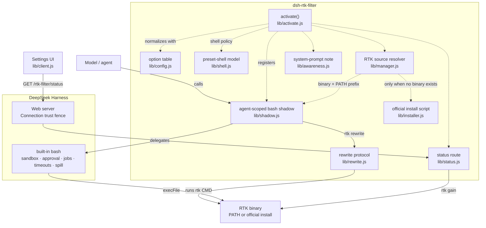

# RTK for DeepSeek Harness

[](https://github.com/okamitimo233/dsh-rtk-filter/actions/workflows/ci.yml)

English | [中文](README_zh.md)

Transparently runs the DeepSeek Harness `bash` tool through [RTK](https://github.com/rtk-ai/rtk)
so condensed command output reaches the model. The plugin adds **no tool** and
changes no tool schema: it registers an agent-scoped `bash` tool that shadows
the built-in one, rewrites each supported command to its `rtk` equivalent, and
then delegates to the original bash implementation.

The plugin uses an existing RTK executable when one is available, either as
`rtk` on the Host `PATH` or at the official install path
`${RTK_INSTALL_DIR:-$HOME/.local/bin}/rtk`. If neither exists, it runs the
official upstream install script once, then uses the installed binary. The
plugin keeps no private binary cache and does not update RTK in the background.

Because execution delegates back to the built-in tool, sandboxing, approval,
background jobs, timeouts, output rendering, spill files, and `[exit code: N]`
markers behave exactly as before. Only the command that runs, its possible
`PATH` overlay, and the output the model reads change.

The same plugin adds **Settings → RTK command filtering** to the Web GUI, with a
compact status dashboard and a placeholder for future options.

## How it works

```
model calls bash("git status")
  -> agent-scoped bash shadow
  -> rtk rewrite "git status"        (0/3 = rewrite, 1 = pass, 2 = deny)
  -> built-in bash runs "rtk git status"
  -> RTK-filtered output returns through the normal bash result path
```

- The shadow's `description`, `parameters`, `output`, timeouts, and
  presentation callbacks are getters over the `bash` definition inherited by
  that agent, captured before the shadow is registered. In the Web surface the
  built-in tool is composed by the agent preset rather than the host global
  plane, so the plugin reads it through the agent's own tool view.
- A short system-prompt section explains that bash output may be condensed by
  RTK. Disable it with `awareness: false`; the tool set never changes.
- All rewrite logic lives in the `rtk` binary (`rtk rewrite`). When filters are
  added to RTK, this plugin picks them up with no change.

## Architecture

Solid arrows show component dependencies and invocation paths; dashed arrows
show activation, binary-management, and settings control relationships. The
command-level round trip is shown in [How it works](#how-it-works).



Shared helpers: `lib/proc.js` owns child-process execution, the abort contract,
and error text. The full module map, dependency rules, and
single-sources-of-truth are in [ARCHITECTURE.md](docs/ARCHITECTURE.md).

## Requirements

- POSIX `bash` (the built-in `bash` tool). Windows `pwsh` is not covered.
- RTK >= 0.23.0 (`rtk rewrite` was introduced there).
- If RTK is not already available, the plugin runs the official quick install
  itself:

```bash
curl -fsSL https://raw.githubusercontent.com/rtk-ai/rtk/refs/heads/master/install.sh | sh
```

  It installs `~/.local/bin/rtk` by default; use `RTK_INSTALL_DIR` to override
  the directory. The plugin normalizes that value once, passes the same
  absolute directory to the installer, and invokes the installed absolute path,
  so adding the directory to `PATH` is convenient but not required. The whole
  download plus install operation is bounded to 30 seconds, so an offline or
  restricted network cannot stall Host startup for minutes.

If installation fails, the plugin logs a warning and stays inert: bash and the
prompt are unchanged.

## Install

Install this repository as a bundle with the DSH Plugin Manager — use the
`plugin_manager` tool with `action: install_bundle` and the absolute path to
this repository directory as `target`. The bundle patch inserts one row:

```yaml
- insert:
    - id: rtk-filter
      name: '@rtk-ai/dsh-rtk-filter'
```

Remove it with `plugin_manager` `action: remove_bundle`.

After installing the bundle, no separate RTK setup is required. The plugin
checks the Host `PATH` and the official install path during activation, and
installs RTK with the official script only when both are missing. A changed
binary or PATH requires a Host reload/restart.

## RTK binary resolution

### Precedence

1. The bare `rtk` command from the Host `PATH`.
2. `${RTK_INSTALL_DIR:-$HOME/.local/bin}/rtk` from a previous official install.
3. If neither is usable, run the official upstream install script and probe
   the installed absolute path.

That is the whole acquisition rule. The plugin never keeps a private copy,
never updates RTK in the background, and never garbage-collects global
installations.

### PATH overlay

The inherited bash tool resolves `rtk` from its own `PATH`. When RTK comes from
an absolute install path, the shadow prepends its directory for each delegated
command so `rtk`, `rtk bypass ...`, and `rtk` calls inside compound commands and
scripts use the same executable:

```
export PATH='<binary-dir>':"$PATH"; <command>
```

The overlay is not applied for the bare `rtk` PATH source, empty commands,
disabled RTK, or when no binary is resolved.

## Configuration

Edit the inserted row in the profile's `cordis.patch.yml` (or the bundle row)
and set `config`:

```yaml
- id: rtk-filter
  name: '@rtk-ai/dsh-rtk-filter'
  config:
    awareness: true                    # default: true
    rewriteTimeoutMs: 2000             # default: 2000
    logRewrites: false                 # default: false
```

| Field | Default | Meaning |
|---|---|---|
| `enabled` | `true` | Turn the plugin off without removing it. |
| `awareness` | `true` | Add the short system-prompt section about condensed output. |
| `rewriteTimeoutMs` | `2000` | Timeout for one `rtk rewrite` call; on timeout the original command runs. |
| `logRewrites` | `false` | Log `[rtk] <original> -> <rewritten>` to the Host log. |

A bundle linked from a checkout cannot resolve DSH's shipped Node packages, so
the generated Config schema is absent there (the row status is `absent` in the
Config inspector). The fields above still work: the row's raw `config` reaches
the plugin and the same defaults apply.

## Settings page

The Web GUI adds **Settings → RTK command filtering** with a compact top bar
for its two views:

- **Status** — runtime health and version, plus a compact dashboard for the
  selected window (last 7 or 30 days): RTK calls, tokens saved, savings rate,
  average saved per call, and a daily savings bar chart. The numbers are read
  from RTK's own local tracking database through `rtk gain --daily --format
  json`; they therefore summarize every command RTK recorded on this machine,
  not only the current browser session.
- **Settings** — a placeholder for future plugin options. Nothing needs tuning
  there today; configuration still lives in the profile row shown above.

The browser reads the aggregate payload from the same-origin
`GET /rtk-filter/status?days=7` resource. The Host route is fenced by the
Connection trust check when that service is composed and never returns command
text or binary paths. Turning the plugin off removes the route; the settings
section then shows its normal retry/error state.

## Behavior

`rtk rewrite` exits with a permission decision; the plugin interprets it the
same way the Pi/OMP and Hermes delegates do, without setting
`RTK_REWRITE_HOST`:

| Exit | Plugin action |
|---|---|
| `0` + stdout | Run the rewritten command. |
| `1` | Run the original command (no filter, or a construct RTK does not rewrite). |
| `2` | Do **not** run; the tool call fails with `rtk denied this command: <message>`. |
| `3` + stdout | Run the rewritten command. DSH owns approval for the bash call, so there is no second prompt. |
| timeout / spawn error / unknown | Fail open: run the original command. |

Additional rules:

- Commands that already start with `rtk` are not rewritten (no recursion); the
  `PATH` overlay still applies when RTK comes from an absolute install path.
- `RTK_DISABLED=1` in the Host environment skips plugin activation entirely.
  A per-command `RTK_DISABLED=1 <cmd>` prefix is skipped by `rtk rewrite`
  itself and runs unchanged.
- `rtk rewrite` runs with the session's working directory, so project-local
  permission rules resolve the way they do for a normal command.

## What the agent sees

- The same one `bash` tool, with the same name, description, and parameters.
- RTK-filtered output for commands RTK supports; unchanged output otherwise.
- A short prompt note that bash output may be condensed and how to recover it
  (`rtk bypass <cmd>`), unless `awareness: false`.

## Limitations

- **Session log**: the durable `tool/call` records the command the model wrote,
  not the rewritten one or the `PATH` overlay. The rewrite is visible in the
  Host log only with `logRewrites: true`.
- **Approval**: DSH has no per-command prompt, so an `ask` rule in Claude Code
  settings (exit 3) does not prompt here; `deny` rules still block. The command
  runs under the approval the `bash` tool call already received.
- **Tool restrictions**: DSH lets scoped registrations remain visible under
  `tools.restrict`, so a preset that denies the global `bash` tool for an agent
  does not hide this shadow. The stock profile and plan mode do not deny
  `bash`.
- **Platform**: POSIX `bash` only; the Windows `pwsh` tool is not filtered.
  RTK itself must provide a compatible build for the Host platform.
- **Inherited definition**: the plugin captures the agent's `bash` definition
  when it installs for that agent. Once the shadow owns the `bash` name the
  agent's own lookup returns the shadow, so a later replacement is not visible
  through `tools/change`; the mirror is re-captured when the agent's preset
  changes, and the shape guard then decides whether the new bash may be
  mirrored. The preset in force is read from the registry projection
  (`presetForSession`), not the creation header: the Web surface creates a
  session under the registry default and selects the user's preset afterwards,
  so a switched session's header records the preset it was born with.
- **Preset shape guard**: the `minimal` preset's bash accepts `command` only.
  When the captured `bash` declares other parameters (the standard
  `dsh-tool-bash` declares `description`/`workdir`, for example), the plugin
  treats that definition as belonging to another plane and installs nothing:
  it filters less rather than changing the tool's schema and execution
  semantics. Unlisted presets are unaffected.
- **Binary ownership**: the plugin keeps no private RTK copy. If it bootstraps
  RTK, it runs the official installer, which writes a normal global executable
  under `${RTK_INSTALL_DIR:-$HOME/.local/bin}`.
- **Trust**: automatic installation executes the upstream `install.sh` over
  HTTPS and relies on that script's own release checksum verification.
- **No background updates**: an existing RTK is never updated by the plugin.
  Installation runs only when neither the PATH nor the official install path
  contains a usable binary. Automatic installation has a single 30-second
  deadline covering both the script download and execution.
- **Activation**: the binary is probed once during activation. Install or
  replace RTK, then reload/restart the Host so the new executable is picked up.

## Development

Unit tests use only Node built-ins and generated fixtures (fake `rtk` scripts,
a fake install-script download, a fake browser/module-loader sandbox, and a
fake Cordis context). No network or real `rtk` is required, so CI runs them on
every push and pull request:

```bash
npm test          # node --test test/*.test.mjs
npm run coverage  # the same suite with 100% line/branch/function thresholds
npm run smoke     # manual real-network install through the upstream script
```

The unit suite never touches the network. The smoke command is for manual or
workflow-dispatch verification and installs RTK into a temporary directory.

## Handoff

See [HANDOFF.md](HANDOFF.md) for the current handoff state, operations quick reference, and next steps. [ARCHITECTURE.md](docs/ARCHITECTURE.md) describes the current module boundaries, constraints, and pitfalls; [COMMIT_REVIEW.md](docs/COMMIT_REVIEW.md) explains why they exist.
