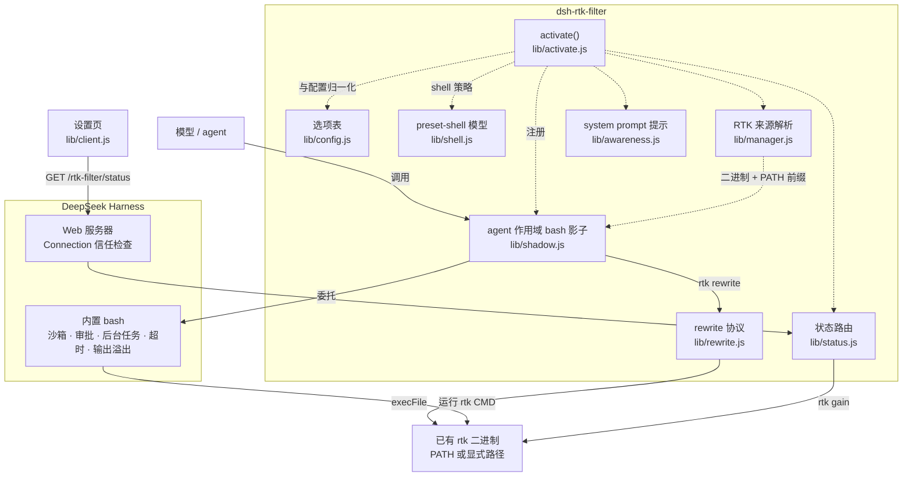

# RTK for DeepSeek Harness

[](https://github.com/okamitimo233/dsh-rtk-filter/actions/workflows/ci.yml)

[English](README.md) | 中文

让 DeepSeek Harness 的 `bash` 工具透明地经由 [RTK](https://github.com/rtk-ai/rtk) 执行，
使压缩后的命令输出送达模型。插件**不新增任何工具**，也不修改任何工具 schema：它注册一个
agent 作用域的 `bash` 工具来遮蔽内置工具，把每条受支持的命令改写为对应的 `rtk` 形式，
然后委托给原始 bash 实现执行。

插件要求系统里已经有可用的 RTK：默认使用 Host `PATH` 上的 `rtk`，也可以通过显式
`binary` 或 `RTK_BIN` 指定。插件本身不会下载、安装、缓存或更新 RTK。

由于执行最终委托回内置工具，沙箱、审批、后台任务、超时、输出渲染、溢出文件以及
`[exit code: N]` 标记的行为都与之前完全一致。发生变化的只有实际执行的命令、可能的
`PATH` 覆盖层，以及模型读到的输出。

插件还会在 Web 界面中增加 **设置 → RTK 命令过滤**：包含一个简洁的状态面板，以及
留给后续可调项的设置占位页。

## 工作原理

```
model calls bash("git status")
  -> agent-scoped bash shadow
  -> rtk rewrite "git status"        (0/3 = rewrite, 1 = pass, 2 = deny)
  -> built-in bash runs "rtk git status"
  -> RTK-filtered output returns through the normal bash result path
```

- 遮蔽工具的 `description`、`parameters`、`output`、超时和展示回调都是 getter，
  读取的是该 agent 所继承的 `bash` 定义——在注册遮蔽工具之前就已捕获。在 Web 界面中，
  内置工具由 agent preset 组装，而不是来自 Host 全局层，因此插件通过 agent 自己的
  工具视图读取它。
- 一段简短的 system prompt 章节用于说明 bash 输出可能被 RTK 压缩。可用
  `awareness: false` 关闭；工具集始终不变。
- 所有改写逻辑都在 `rtk` 二进制中（`rtk rewrite`）。当 RTK 新增过滤器时，本插件无需
  改动即可自动用上。

## 架构

实线表示组件依赖与调用路径，虚线表示激活、二进制管理和设置页的控制关系。
单次命令的往返流程见[工作原理](#工作原理)。



共享辅助模块：`lib/proc.js` 负责子进程执行、abort 契约与错误文本。
完整的模块地图、依赖规则与“唯一来源”清单见 [ARCHITECTURE.md](docs/ARCHITECTURE.md)。

## 环境要求

- POSIX `bash`（即内置 `bash` 工具）。不覆盖 Windows 的 `pwsh`。
- 需要 RTK >= 0.23.0（即引入 `rtk rewrite` 的版本），并满足以下任一来源：
  Host `PATH` 上的 `rtk`、显式 `binary`、或 `RTK_BIN`。
- 官方 quick install：

```bash
curl -fsSL https://raw.githubusercontent.com/rtk-ai/rtk/refs/heads/master/install.sh | sh
```

  默认安装到 `~/.local/bin/rtk`，可用 `RTK_INSTALL_DIR` 覆盖目录。请确保该目录在
  Host 的 `PATH` 中。

如果无法解析到可用的二进制，插件会记录警告并保持惰性：bash 和 prompt 都不变。

## 安装

使用 DSH Plugin Manager 把本仓库作为 bundle 安装——调用 `plugin_manager` 工具，
`action: install_bundle`，`target` 为本仓库目录的绝对路径。bundle patch 会插入一行：

```yaml
- insert:
    - id: rtk-filter
      name: '@rtk-ai/dsh-rtk-filter'
```

用 `plugin_manager` 的 `action: remove_bundle` 卸载。

安装 bundle 后，确认 Host 能解析到 RTK。插件在激活时探测一次；替换二进制或修改 PATH 后
需要重新加载/重启 Host。

## RTK 二进制解析

### 优先级

1. Host 环境中的 `RTK_BIN`，或非默认的 `binary` 配置：原样使用该显式可执行文件。
2. 否则使用 Host `PATH` 上的裸 `rtk` 命令。

显式二进制不可用时不会回退到 `PATH`；插件也不会下载、安装、更新或回收 RTK。

### PATH 覆盖层

继承的 bash 工具从自己的 `PATH` 解析 `rtk`。当选中的是绝对路径的显式二进制时，影子会为
每个委托命令把其所在目录前置到 `PATH`，使 `rtk`、`rtk bypass ...` 以及复合命令和脚本中的
`rtk` 调用都使用同一个可执行文件：

```
export PATH='<binary-dir>':"$PATH"; <command>
```

当来源是 `PATH` 上的裸 `rtk`、命令为空、RTK 被禁用，或没有解析到二进制时不应用覆盖层。

## 配置

编辑 profile 的 `cordis.patch.yml` 中被插入的那一行（或 bundle 行），设置 `config`：

```yaml
- id: rtk-filter
  name: '@rtk-ai/dsh-rtk-filter'
  config:
    binary: /home/user/.local/bin/rtk  # 默认: rtk（Host PATH）
    awareness: true                    # 默认: true
    rewriteTimeoutMs: 2000             # 默认: 2000
    logRewrites: false                 # 默认: false
```

| 字段 | 默认值 | 含义 |
|---|---|---|
| `enabled` | `true` | 在不移除插件的情况下将其关闭。 |
| `awareness` | `true` | 添加关于压缩输出的简短 system prompt 章节。 |
| `binary` | `rtk` | RTK 可执行文件。默认使用 Host `PATH`；绝对路径表示显式二进制。`RTK_BIN` 优先。 |
| `rewriteTimeoutMs` | `2000` | 单次 `rtk rewrite` 调用的超时；超时后执行原命令。 |
| `logRewrites` | `false` | 向 Host 日志记录 `[rtk] <original> -> <rewritten>`。 |

从 checkout 链接的 bundle 无法解析 DSH 自带的 Node 包，因此在那里生成的 Config schema
是缺失的（Config 检查器中的行状态为 `absent`）。上表中的字段仍然有效：该行的原始
`config` 会送达插件，默认值也同样适用。

## 设置页

Web 界面会在 **设置 → RTK 命令过滤** 中增加一个顶部切换栏，里面有两部分：

- **状态** — 展示运行状态与版本，以及所选时间窗口（近 7 天 / 近 30 天）的简洁面板：
  RTK 调用次数、节省 Token、节省比例、平均每次节省，以及每日节省柱状图。数据通过
  `rtk gain --daily --format json` 读取 RTK 自己的本地跟踪库，因此统计的是本机 RTK
  记录过的全部命令，而不只是当前浏览器会话。
- **设置** — 预留给以后的可调选项。目前无需配置，插件参数仍通过上面的 profile 行管理。

浏览器从同源 `GET /rtk-filter/status?days=7` 读取聚合数据。Host 路由在 Connection
服务存在时会经过其信任检查，且不会返回命令文本或二进制路径。关闭插件后该路由会消失，
设置页会显示正常的重试/错误状态。

## 行为

`rtk rewrite` 以一个权限决策作为退出码；插件按 Pi/OMP 和 Hermes 委托的同样方式解释它，
并且不设置 `RTK_REWRITE_HOST`：

| 退出码 | 插件动作 |
|---|---|
| `0` + stdout | 执行改写后的命令。 |
| `1` | 执行原命令（没有可用过滤器，或 RTK 不改写该结构）。 |
| `2` | **不**执行；工具调用失败并返回 `rtk denied this command: <message>`。 |
| `3` + stdout | 执行改写后的命令。bash 调用的审批由 DSH 负责，因此不会二次提示。 |
| 超时 / spawn 错误 / 未知 | 失败即放行（fail open）：执行原命令。 |

其他规则：

- 已经以 `rtk` 开头的命令不会被改写（避免递归）；显式绝对路径二进制生效时 `PATH` 覆盖层仍然应用。
- Host 环境中的 `RTK_DISABLED=1` 会完全跳过插件激活。
  单条命令前缀 `RTK_DISABLED=1 <cmd>` 由 `rtk rewrite` 自身跳过，原样执行。
- `rtk rewrite` 以会话的工作目录运行，因此项目本地的权限规则会像普通命令那样解析。

## Agent 看到什么

- 仍然是同一个 `bash` 工具，名称、描述和参数都不变。
- RTK 支持的命令得到 RTK 压缩后的输出；其余命令输出不变。
- 一条简短的 prompt 提示：bash 输出可能被压缩，以及如何恢复（`rtk bypass <cmd>`）——
  除非设置了 `awareness: false`。

## 限制

- **会话日志**：持久化的 `tool/call` 记录的是模型写入的命令，而不是改写后的命令或
  `PATH` 覆盖层。只有开启 `logRewrites: true` 时，改写才在 Host 日志中可见。
- **审批**：DSH 没有按命令的提示，因此 Claude Code 设置中的 `ask` 规则（退出码 3）
  在这里不会触发提示；`deny` 规则仍会拦截。命令在该 `bash` 调用已获得的审批下执行。
- **工具限制**：DSH 允许作用域注册在 `tools.restrict` 下仍然可见，因此某个 preset 为
  某个 agent 禁用了全局 `bash` 工具，也不会隐藏这个遮蔽工具。stock profile 和 plan mode
  都不禁用 `bash`。
- **平台**：仅 POSIX `bash`；Windows 的 `pwsh` 工具不会被过滤。RTK 本身需要提供与 Host
  平台匹配的构建。
- **继承的定义**：插件在为其 agent 安装时捕获该 agent 的 `bash` 定义。影子一旦占住
  `bash` 名字，agent 自己的查找只会返回影子，因此之后的上游替换在 `tools/change` 里
  看不见；切换 preset 时插件会丢弃旧影子并重新捕获，再由形状守卫决定新 bash 能否被镜像。
  “当前 preset”取自注册表投影（`presetForSession`），而不是创建时的 header：Web 端先用
  registry 默认 preset 建会话、随后才选中用户的 preset，所以切换过的会话 header 记的是
  它出生时的那个。
- **preset 形状守卫**：极简模式（`minimal`）的 bash 只接受 `command`。若捕获到的 `bash`
  声明了其它参数（例如标准 `dsh-tool-bash` 的 `description`/`workdir`），插件判定这份
  定义不属于该 preset，宁可不安装、不过滤，也不改变工具 schema 与执行语义。未登记的
  preset 不受影响。
- **二进制归属**：RTK 的安装与更新由插件之外负责。插件只调用解析到的可执行文件，
  没有需要维护的缓存。
- **激活时机**：二进制在激活时探测一次。请先安装或替换 RTK，再重新加载/重启 Host，
  以便重新解析。

## 开发

单元测试只依赖 Node 内置模块和测试夹具（fake `rtk` 脚本、fake 浏览器/模块加载器沙箱、
fake Cordis Context），不需要网络或真实 `rtk`；CI 在每次 push/PR 上运行：

```bash
npm test          # node --test test/*.test.mjs
npm run coverage  # 同一套测试 + 行/分支/函数 100% 阈值
```

## Handoff

当前交接状态、运维速查和下一步见 [HANDOFF.md](HANDOFF.md)。模块边界、约束与坑点见
[ARCHITECTURE.md](docs/ARCHITECTURE.md)；重构动机与提交考古见
[COMMIT_REVIEW.md](docs/COMMIT_REVIEW.md)。
