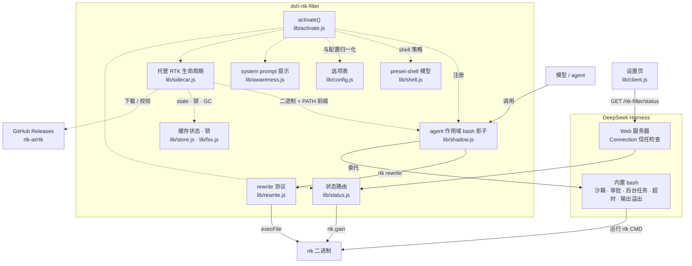

# RTK for DeepSeek Harness

[English](README.md) | 中文

让 DeepSeek Harness 的 `bash` 工具透明地经由 [RTK](https://github.com/rtk-ai/rtk) 执行，
使压缩后的命令输出送达模型。插件**不新增任何工具**，也不修改任何工具 schema：它注册一个
agent 作用域的 `bash` 工具来遮蔽内置工具，把每条受支持的命令改写为对应的 `rtk` 形式，
然后委托给原始 bash 实现执行。

插件还会在 `$DSH_HOME/cache/rtk-filter` 下自行安装并更新 RTK 二进制。用户不需要全局安装
RTK；bundle 或链接安装也不会写入用户的 `PATH` 目录。

由于执行最终委托回内置工具，沙箱、审批、后台任务、超时、输出渲染、溢出文件以及
`[exit code: N]` 标记的行为都与之前完全一致。发生变化的只有实际执行的命令、托管二进制
生效时的 `PATH` 覆盖层，以及模型读到的输出。

插件还会在 Web 界面中增加 **设置 → RTK 命令过滤**：包含一个简洁的状态面板，以及
留给后续可调项的设置占位页。

## 工作原理

```
model calls bash("git status")
  -> agent-scoped bash shadow
  -> rtk rewrite "git status"        (0/3 = rewrite, 1 = pass, 2 = deny)
  -> built-in bash runs "rtk git status", with the managed rtk on PATH
  -> RTK-filtered output returns through the normal bash result path
```

- 遮蔽工具的 `description`、`parameters`、`output`、超时和展示回调都是 getter，
  读取的是该 agent 所继承的 `bash` 定义——在注册遮蔽工具之前就已捕获。在 Web 界面中，
  内置工具由 agent preset 组装，而不是来自 Host 全局层，因此插件通过 agent 自己的
  工具视图读取它。
- 一段简短的 system prompt 章节用于说明 bash 输出可能被 RTK 压缩。可用
  `awareness: false` 关闭；工具集始终不变。
- 所有改写逻辑都在 `rtk` 二进制中（`rtk rewrite`）。当 RTK 新增过滤器时，本插件无需
  改动即可自动用上。

## 架构

实线表示组件依赖与调用路径，虚线表示激活、二进制管理和设置页的控制关系。
单次命令的往返流程见[工作原理](#工作原理)。



共享辅助模块：`lib/proc.js`（子进程、abort 契约、错误文本）同时被过滤路径与安装器使用。
完整的模块地图、依赖规则与“唯一来源”清单见 [ARCHITECTURE.md](docs/ARCHITECTURE.md)。

## 环境要求

- POSIX `bash`（即内置 `bash` 工具）。不覆盖 Windows 的 `pwsh`。
- 不需要系统安装 `rtk`。插件会在首次使用时下载并校验自己的副本（RTK >= 0.23.0，
  即引入 `rtk rewrite` 的版本）。
- 首次激活需要访问 `github.com`，除非 `binary` 或 `RTK_BIN` 指向已有的可执行文件。
- 显式 `binary` 必须是一个名为 `rtk` 的可执行文件（或通过 `PATH` 解析的裸 `rtk`
  命令）；改写后的命令调用的是 `rtk`。

如果无法获得任何二进制，插件会记录一条警告并保持惰性：bash 和 prompt 都不会被改动。

## 安装

使用 DSH Plugin Manager 把本仓库作为 bundle 安装——调用 `plugin_manager` 工具，
`action: install_bundle`，`target` 为本仓库目录的绝对路径。bundle patch 会插入一行：

```yaml
- insert:
    - id: rtk-filter
      name: '@rtk-ai/dsh-rtk-filter'
```

用 `plugin_manager` 的 `action: remove_bundle` 卸载。

首次激活会在后台开始下载 RTK。二进制就绪后自动开始过滤；不需要重启，也不需要执行任何
shell 命令。

## RTK 二进制生命周期

### 存放位置

```
$DSH_HOME/cache/rtk-filter/                  # 默认 ~/.dsh/cache/rtk-filter
  versions/<edition>/<target>/<version>/rtk  # 可执行文件，权限 0755
  state/<edition>__<target>.json             # 该 target 已安装的版本
  latest.json                                # 缓存的最新稳定 tag
  locks/                                     # 跨进程安装锁
  tmp/                                       # 暂存区；过期条目会被清理
```

`$DSH_HOME` 依次读取当前 profile（`profileContext.home`）、`$DSH_HOME`、`~/.dsh`。
缓存归用户所有，并由各 DSH profile 共享；它不会被加入操作系统 `PATH` 或任何 shell 配置。

### 优先级

1. Host 环境中的 `RTK_BIN`，或非默认的 `binary` 配置：原样使用。不下载、不更新。
2. 插件托管的副本，由插件负责更新。
3. Host `PATH` 上的系统 `rtk`：在托管副本下载期间作为临时回退立即使用；如果下载失败，
   则作为长期回退。
4. 如果都没有且启用了 `autoInstall`，在后台下载最新稳定版，就绪后开始过滤。
5. 否则保持惰性并记录警告；bash 和 prompt 不变。

托管副本一旦就绪就优先于 `PATH`，因此 `PATH` 安装永远不会被修改，更新由插件控制。

### 安装与更新

- 从 `https://github.com/rtk-ai/rtk/releases/latest` 解析最新稳定 tag；GitHub API 仅作为
  回退。
- 下载对应的 `rtk-<target>.tar.gz`（或 `rtk-oss-<target>.tar.gz`）以及 `checksums.txt`；
  解压前校验 SHA-256。
- 归档使用 Node 的 `zlib` 和防御性 tar 解析器读取：拒绝不安全路径、链接、重复条目、
  截断和超大条目。
- 解压出的 `rtk` 先运行 `--version`（必须匹配请求的 tag 且 >= 0.23.0），再运行
  `rtk rewrite` 冒烟测试（`git status` 或 `ls`，至少一个必须产生改写），通过后才发布。
- 发布方式是原子重命名到版本化目录，然后原子写 state。更新永远不会覆盖正在运行的二进制。
- `autoUpdate` 每隔 `updateIntervalMs`（默认 24 小时）检查一次；当最新稳定 tag 更新时升级
  托管副本。上一个版本会保留，更旧的版本会被 GC。
- `version` 固定精确 tag（`1.2.0` 或 `v1.2.0`）并禁用最新版本查询。只有显式固定时才会降级。
- `edition: rtk-oss` 下载仅 Apache-2.0 的构建，而不是默认的 `rtk`（Apache-2.0 CLI +
  BUSL-1.1 engine）。插件从上游下载 release，不再分发它。归档中的 `LICENSE` 和
  `LICENSE-ENGINE` 会与二进制一起保留。

信任模型是 HTTPS + 上游 SHA-256 + 本地 rewrite 冒烟测试；上游不提供签名。设置
`autoInstall: false` 可完全选择不下载。

### 使用托管二进制运行

继承的 bash 工具从自己的 `PATH` 解析 `rtk`，而不是从插件配置的二进制。当托管（或显式
绝对路径）二进制生效时，影子会为每个委托命令把其所在目录前置到 `PATH`：

```
export PATH='<version-dir>':"$PATH"; <command>
```

这样 `rtk`、`rtk bypass ...` 以及复合命令和脚本中的 `rtk` 调用都能工作。当选中的是
`PATH` 上的裸 `rtk`、尚无二进制就绪、命令为空，或设置了 `RTK_DISABLED=1` 时不应用该覆盖层。

## 配置

编辑 profile 的 `cordis.patch.yml` 中被插入的那一行（或 bundle 行），设置 `config`：

```yaml
- id: rtk-filter
  name: '@rtk-ai/dsh-rtk-filter'
  config:
    autoInstall: true          # default: true
    autoUpdate: true           # default: true
    version: latest            # default: latest, or a tag such as v1.2.0
    edition: rtk               # default: rtk, or rtk-oss
    awareness: true            # default: true
    rewriteTimeoutMs: 2000     # default: 2000
    logRewrites: false         # default: false
```

| 字段 | 默认值 | 含义 |
|---|---|---|
| `enabled` | `true` | 在不移除插件的情况下将其关闭。 |
| `awareness` | `true` | 添加关于压缩输出的简短 system prompt 章节。 |
| `binary` | `rtk` | 显式 rtk 可执行文件。设置它（或 `RTK_BIN`）会禁用托管安装/更新；使用绝对路径或裸 `rtk`。 |
| `autoInstall` | `true` | 没有托管副本时下载插件自有二进制。 |
| `autoUpdate` | `true` | 检查 GitHub 并升级托管副本。`PATH` 和显式二进制永远不会被更新。 |
| `version` | `latest` | 固定精确稳定 tag；禁用最新版本查询。 |
| `edition` | `rtk` | `rtk` 或仅 Apache-2.0 的 `rtk-oss`。 |
| `updateIntervalMs` | `86400000` | 两次最新 tag 检查之间的最短时间。 |
| `downloadTimeoutMs` | `120000` | 单次 checksums 或归档请求的超时。 |
| `rewriteTimeoutMs` | `2000` | 单次 `rtk rewrite` 调用的超时；超时后执行原命令。 |
| `logRewrites` | `false` | 向 Host 日志记录 `[rtk] <original> -> <rewritten>`。 |

从 checkout 链接的 bundle 无法解析 DSH 自带的 Node 包，因此在那里生成的 Config schema
是缺失的（Config 检查器中的行状态为 `absent`）。上表中的字段仍然有效：该行的原始
`config` 会送达插件，默认值也同样适用。

## 设置页

Web 界面会在 **设置 → RTK 命令过滤** 中增加一个顶部切换栏，里面有两部分：

- **状态** — 展示运行状态与版本，以及所选时间窗口（近 7 天 / 近 30 天）的简洁面板：
  RTK 调用次数、节省 Token、节省比例、平均每次节省，以及每日节省柱状图。数据通过
  `rtk gain --daily --format json` 读取 RTK 自己的本地跟踪库，因此统计的是本机 RTK
  记录过的全部命令，而不只是当前浏览器会话。
- **设置** — 预留给以后的可调选项。目前无需配置，插件参数仍通过上面的 profile 行管理。

浏览器从同源 `GET /rtk-filter/status?days=7` 读取聚合数据。Host 路由在 Connection
服务存在时会经过其信任检查，且不会返回命令文本或二进制路径。关闭插件后该路由会消失，
设置页会显示正常的重试/错误状态。

## 行为

`rtk rewrite` 以一个权限决策作为退出码；插件按 Pi/OMP 和 Hermes 委托的同样方式解释它，
并且不设置 `RTK_REWRITE_HOST`：

| 退出码 | 插件动作 |
|---|---|
| `0` + stdout | 执行改写后的命令。 |
| `1` | 执行原命令（没有可用过滤器，或 RTK 不改写该结构）。 |
| `2` | **不**执行；工具调用失败并返回 `rtk denied this command: <message>`。 |
| `3` + stdout | 执行改写后的命令。bash 调用的审批由 DSH 负责，因此不会二次提示。 |
| 超时 / spawn 错误 / 未知 | 失败即放行（fail open）：执行原命令。 |

其他规则：

- 已经以 `rtk` 开头的命令不会被改写（避免递归）；托管二进制生效时 `PATH` 覆盖层仍然应用。
- Host 环境中的 `RTK_DISABLED=1` 会完全跳过插件激活。
  单条命令前缀 `RTK_DISABLED=1 <cmd>` 由 `rtk rewrite` 自身跳过，原样执行。
- `rtk rewrite` 以会话的工作目录运行，因此项目本地的权限规则会像普通命令那样解析。

## Agent 看到什么

- 仍然是同一个 `bash` 工具，名称、描述和参数都不变。
- RTK 支持的命令得到 RTK 压缩后的输出；其余命令输出不变。
- 一条简短的 prompt 提示：bash 输出可能被压缩，以及如何恢复（`rtk bypass <cmd>`）——
  除非设置了 `awareness: false`。

## 限制

- **会话日志**：持久化的 `tool/call` 记录的是模型写入的命令，而不是改写后的命令或
  `PATH` 覆盖层。只有开启 `logRewrites: true` 时，改写才在 Host 日志中可见。
- **审批**：DSH 没有按命令的提示，因此 Claude Code 设置中的 `ask` 规则（退出码 3）
  在这里不会触发提示；`deny` 规则仍会拦截。命令在该 `bash` 调用已获得的审批下执行。
- **工具限制**：DSH 允许作用域注册在 `tools.restrict` 下仍然可见，因此某个 preset 为
  某个 agent 禁用了全局 `bash` 工具，也不会隐藏这个遮蔽工具。stock profile 和 plan mode
  都不禁用 `bash`。
- **平台**：仅 POSIX `bash`；Windows 的 `pwsh` 工具不会被过滤。托管下载支持 Linux 和
  macOS 的 x64 与 arm64。
- **继承的定义**：插件在为其 agent 安装时捕获该 agent 的 `bash` 定义。影子一旦占住
  `bash` 名字，agent 自己的查找只会返回影子，因此之后的上游替换在 `tools/change` 里
  看不见；切换 preset 时插件会丢弃旧影子并重新捕获，再由形状守卫决定新 bash 能否被镜像。
  “当前 preset”取自注册表投影（`presetForSession`），而不是创建时的 header：Web 端先用
  registry 默认 preset 建会话、随后才选中用户的 preset，所以切换过的会话 header 记的是
  它出生时的那个。
- **preset 形状守卫**：极简模式（`minimal`）的 bash 只接受 `command`。若捕获到的 `bash`
  声明了其它参数（例如标准 `dsh-tool-bash` 的 `description`/`workdir`），插件判定这份
  定义不属于该 preset，宁可不安装、不过滤，也不改变工具 schema 与执行语义。未登记的
  preset 不受影响。
- **托管二进制的范围**：插件自有的 RTK 只出现在它委托的 bash 调用的 `PATH` 中，不在
  用户终端或其他 DSH 进程里。系统 `rtk` 不会被插件更新；显式 `binary`/`RTK_BIN`
  永远不会被托管。
- **首次激活**：没有可用二进制且 `autoInstall: true` 时，在后台下载完成前无法过滤。
  如果网络被阻断，插件会回退到系统 `rtk`，或保持惰性并记录警告。
- **信任**：下载只通过上游 SHA-256 校验和验证，没有签名。不允许第三方下载的环境应设置
  `autoInstall: false` 并使用显式 `binary`。
- **缓存维护**：删除 `$DSH_HOME/cache/rtk-filter` 会在下次激活时强制重新安装。缓存对每个
  edition/target 保留当前版本和一个上一版本。

## 开发

单元测试只依赖 Node 内置模块和生成的 tar 测试夹具：

```bash
node --test test/*.test.mjs
```

可以用临时 home 针对上游跑一次 release 流程；整个过程不涉及全局安装：

```bash
DSH_HOME=$(mktemp -d) node --input-type=module -e "
import { createRtkManager } from './lib/sidecar.js'
import { probeRtk, rewriteCommand } from './lib/rewrite.js'
const manager = await createRtkManager({
  ctx: { get: () => ({ home: process.env.DSH_HOME }) },
  settings: { autoUpdate: false },
  deps: {
    probeRtk,
    smokeRewrite: async ({ binary, signal }) =>
      (await rewriteCommand({ binary, command: 'git status', signal })).kind === 'rewrite'
        ? { ok: true } : { ok: false, reason: 'no rewrite' },
    logger: console,
  },
})
console.log(await manager.start().ready, manager.current())
manager.dispose()
"
```

## Handoff

实现历史、运维说明、验证记录和已知坑点见 [HANDOFF.md](HANDOFF.md)。当前模块边界见
[ARCHITECTURE.md](docs/ARCHITECTURE.md)；重构动机与提交考古见
[COMMIT_REVIEW.md](docs/COMMIT_REVIEW.md)。
